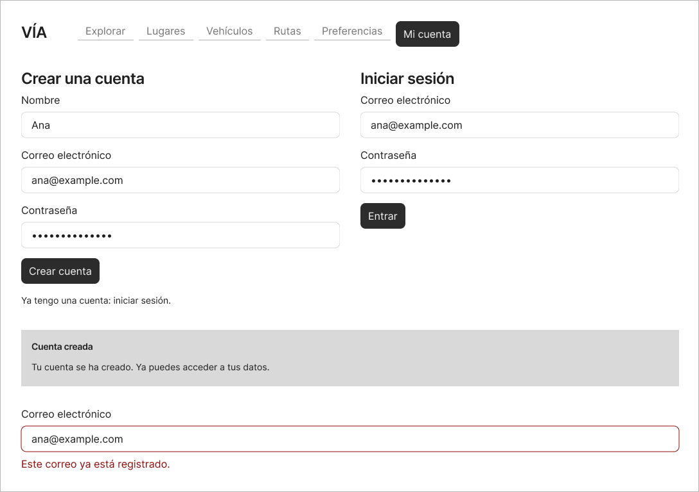
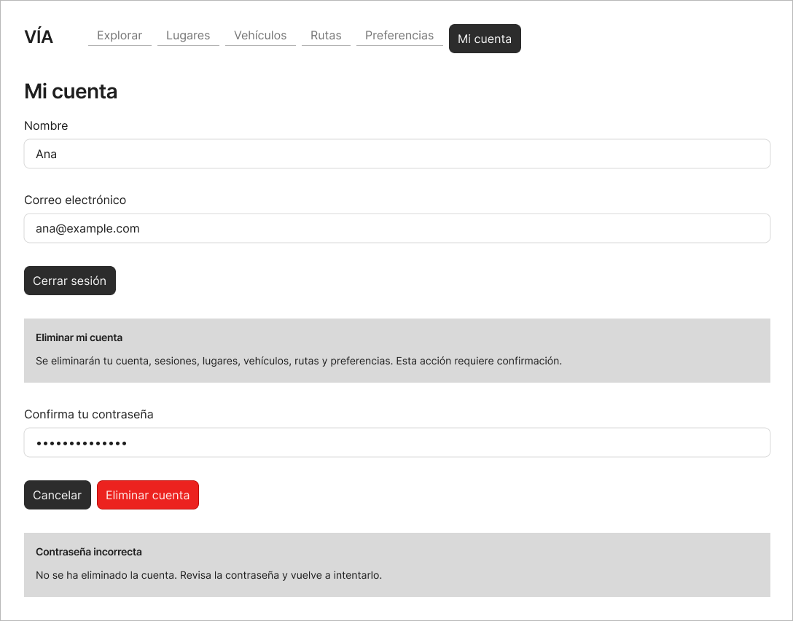
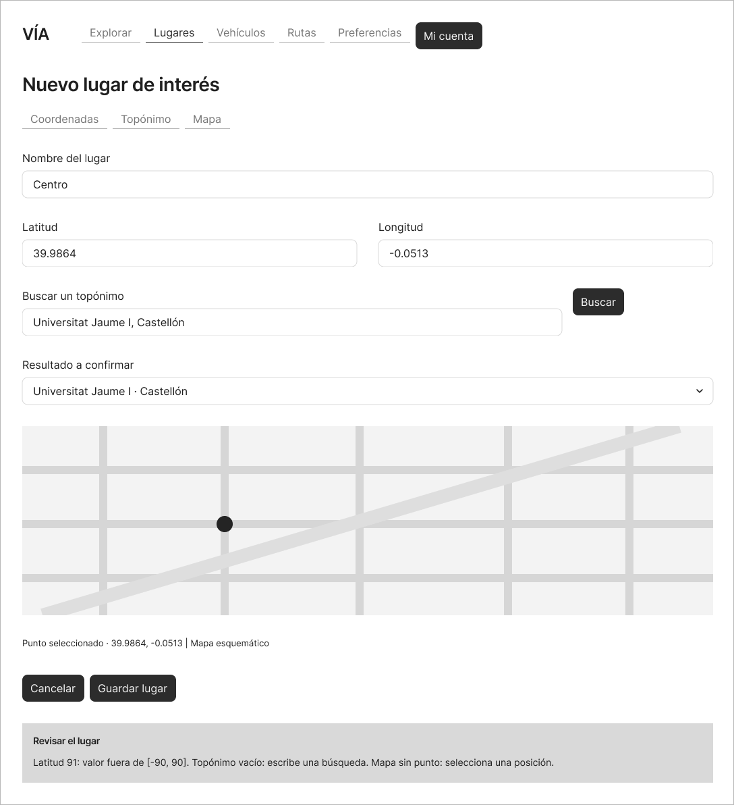
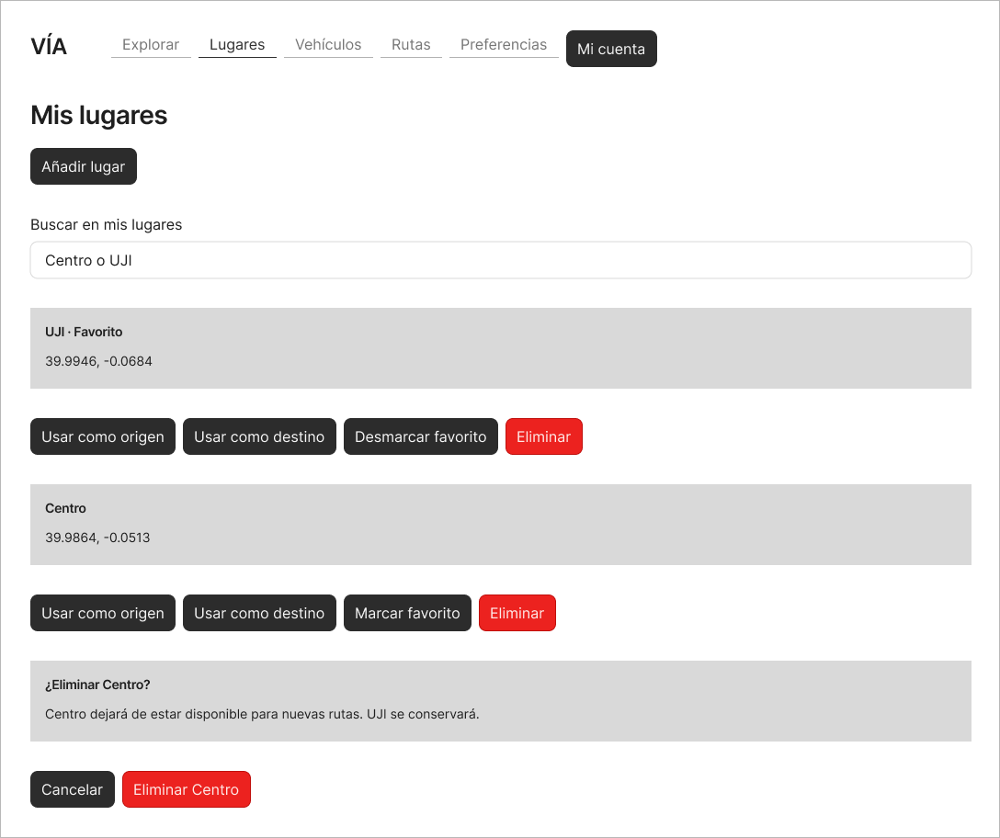
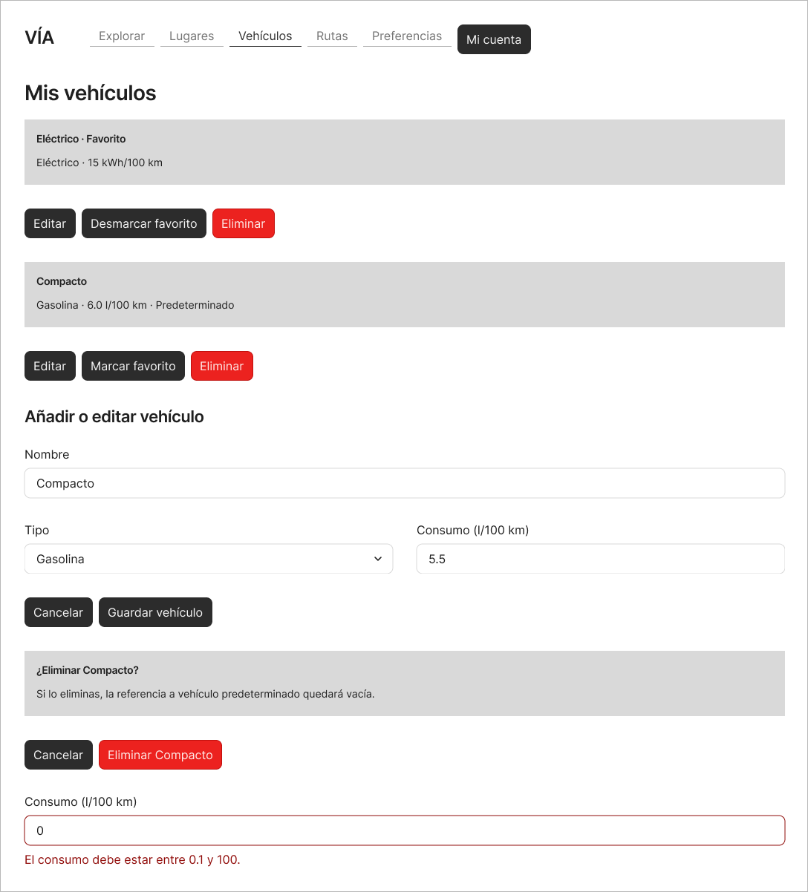
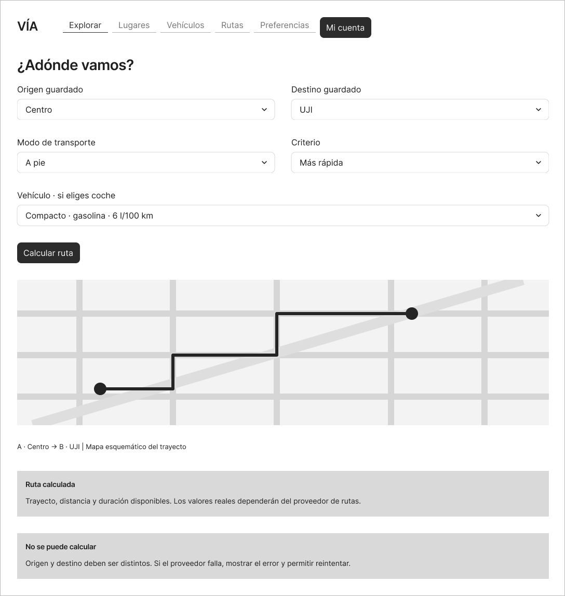
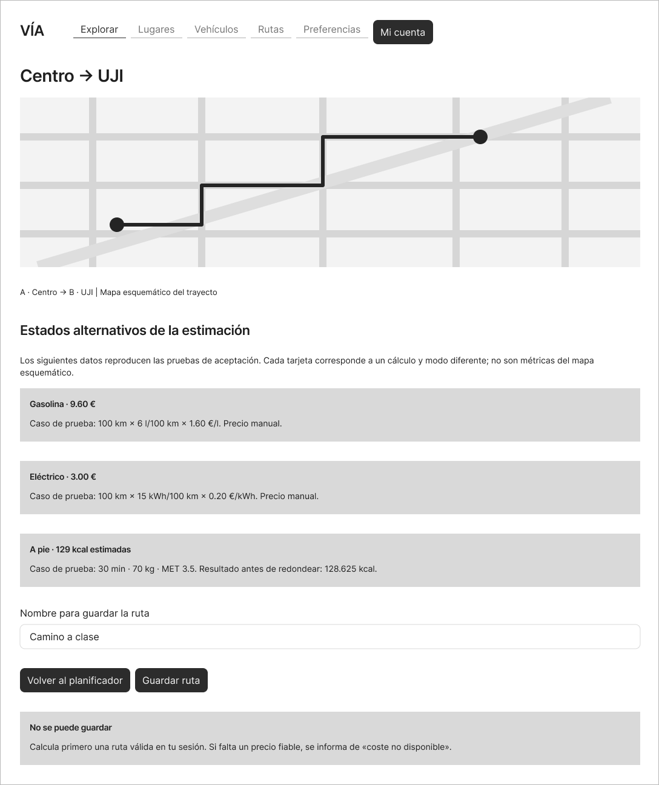
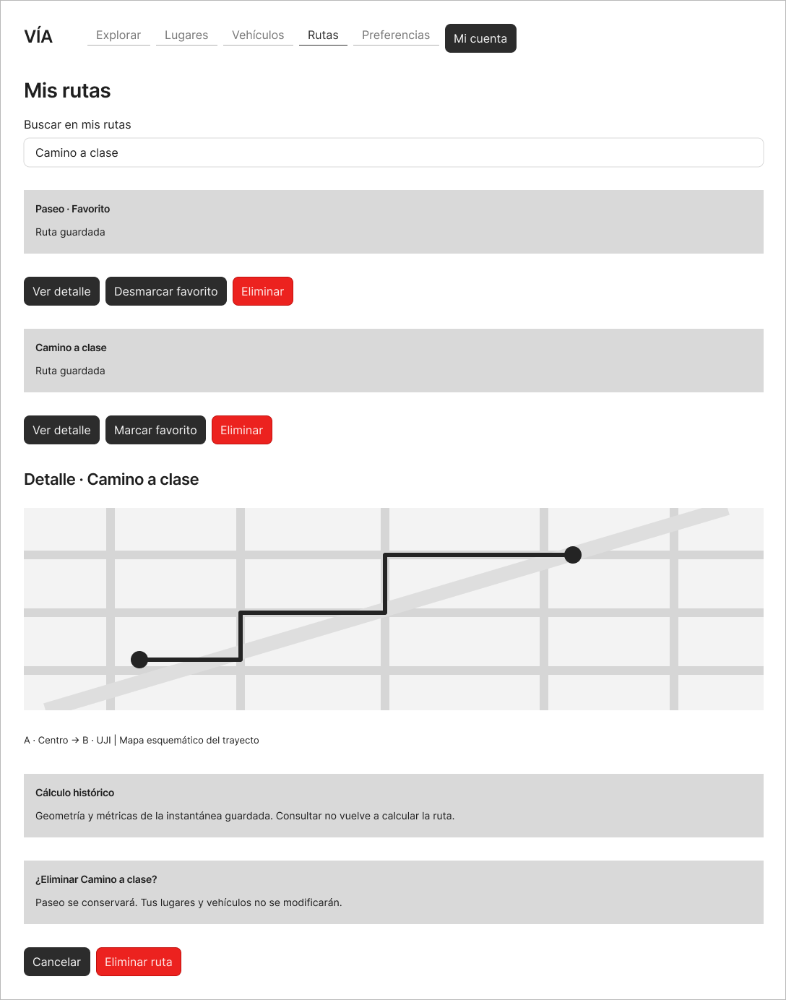
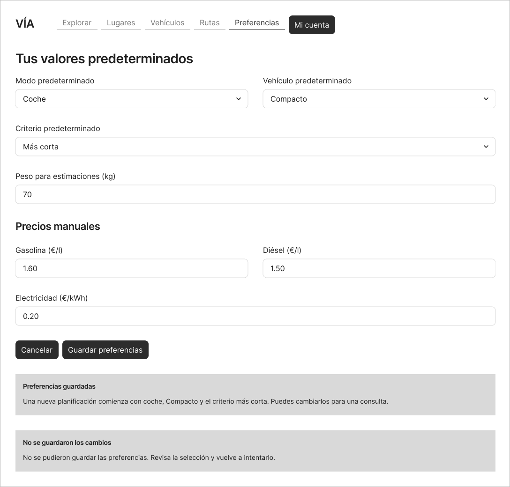
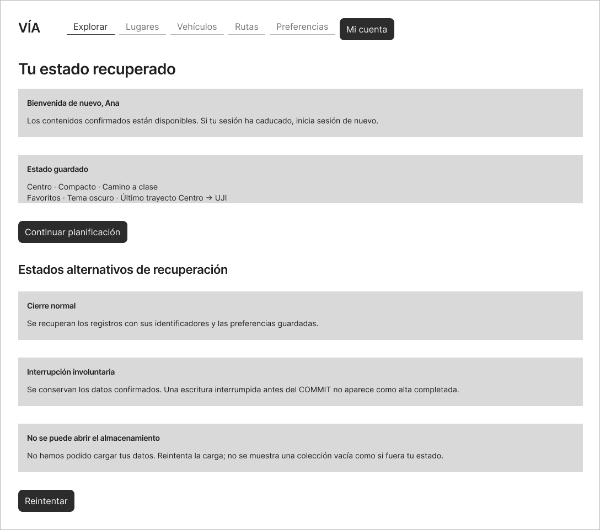

# Del escenario a la pantalla

Los mockups proponen la interfaz de Vía a partir de las historias y escenarios del apartado 4. Se han elaborado en Figma y se organizan en diez pantallas, M01 a M10, que cubren las 26 historias de usuario.

Las imágenes siguientes muestran la propuesta actual. Los mapas son esquemáticos y los valores de las estimaciones son datos de prueba. Los estados alternativos reunidos en una figura no tienen por qué aparecer simultáneamente en el producto. Los límites y decisiones pendientes de validar mantienen ese carácter.

## M01. Registro e inicio de sesión

**Historias relacionadas** HU-01, HU-02.

Permite crear una cuenta o acceder con una cuenta existente.

**Escenario válido** El registro crea una sola cuenta. El acceso recupera únicamente los datos de su titular.

**Escenario inválido** Correo duplicado o credenciales incorrectas. Se informa del error sin crear una cuenta o sesión adicional.

## M02. Mi cuenta y cierre de sesión

**Historias relacionadas** HU-03, HU-04.

Reúne los datos de la cuenta, el cierre de sesión y la confirmación de su eliminación.

**Escenario válido** Cerrar sesión impide usar de nuevo esa sesión. Eliminar la cuenta con la contraseña correcta borra sus datos asociados.

**Escenario inválido** Una sesión ya cerrada no puede cerrarse de nuevo. Una contraseña incorrecta impide eliminar la cuenta.

## M03. Añadir un lugar

**Historias relacionadas** HU-05, HU-06, HU-09.

Ofrece alta por coordenadas, búsqueda de topónimo con confirmación y selección de un punto en el mapa.

**Escenario válido** Se guarda el lugar con las coordenadas introducidas, el candidato confirmado o el punto elegido.

**Escenario inválido** Latitud 91, topónimo vacío o ausencia de punto seleccionado. No se crea ningún lugar.

## M04. Mis lugares

**Historias relacionadas** HU-07, HU-08, HU-22.

Muestra los lugares propios, su selección para rutas, los favoritos y la confirmación de borrado.

**Escenario válido** Ana consulta Centro y UJI. Borrar Centro conserva UJI. Los favoritos aparecen primero.

**Escenario inválido** Sin sesión se solicita acceso. Si un lugar ya se ha eliminado, se informa y se actualiza la lista.

## M05. Mis vehículos

**Historias relacionadas** HU-10, HU-11, HU-12, HU-13, HU-22.

Incluye consulta, alta, edición, favoritos y eliminación de vehículos, con las unidades del consumo.

**Escenario válido** Se registra Compacto. Editar su consumo conserva el identificador. Borrarlo limpia la referencia predeterminada.

**Escenario inválido** Un consumo inválido impide guardar. Si el vehículo ya no está disponible, se informa y se actualiza la lista.

## M06. Planificar un trayecto

**Historias relacionadas** HU-14, HU-18.

Explorar permite buscar los extremos, elegir puntos en el mapa o usar lugares guardados. Ofrece una referencia de consumo editable y muestra los precios.

**Escenario válido** Centro \(\rightarrow\) UJI devuelve geometría y métricas positivas. El criterio económico compara las alternativas recibidas.

**Escenario inválido** Extremos coincidentes o destino sin seleccionar impiden calcular. Los fallos del proveedor permiten reintentar.

## M07. Resultado y estimaciones

**Historias relacionadas** HU-15, HU-16, HU-17, HU-19.

Reúne estados alternativos de coste de combustible, electricidad y calorías, y la acción de guardar una ruta.

**Escenario válido** Las cifras de la figura ilustran cálculos con datos preparados. No son las medidas que deba devolver el servicio de rutas para Centro y UJI. Un resultado calculado para la cuenta puede guardarse.

**Escenario inválido** Un precio o peso inválido conserva el valor anterior. Un nombre vacío impide guardar una ruta.

## M08. Rutas guardadas

**Historias relacionadas** HU-20, HU-21, HU-22.

Permite consultar copias históricas, gestionar favoritos y confirmar la eliminación de una ruta.

**Escenario válido** Consultar conserva geometría y métricas históricas. Borrar Camino a clase mantiene Paseo, lugares y vehículos.

**Escenario inválido** Sin sesión se solicita acceso. Si una ruta ya se ha eliminado, se informa y se actualiza la lista.

## M09. Preferencias

**Historias relacionadas** HU-23, HU-24. Configuración de HU-15, HU-16 y HU-17.

Presenta modo, vehículo y criterio predeterminados, peso y precios manuales con sus unidades.

**Escenario válido** Una nueva planificación usa coche, Compacto y más corta, permitiendo cambios puntuales.

**Escenario inválido** Un vehículo eliminado no puede guardarse como predeterminado. Un fallo de guardado conserva la preferencia anterior.

## M10. Volver a la aplicación

**Historias relacionadas** HU-25, HU-26.

Representa recuperación tras cierre normal o interrupción, y el fallo al abrir el almacenamiento.

**Escenario válido** Se recuperan contenidos confirmados, identificadores, favoritos, tema y último trayecto.

**Escenario inválido** Un fallo de carga no se presenta como lista vacía. Una transacción sin COMMIT no debe aparecer como alta confirmada.

La relación con las historias permite revisar cada pantalla junto con sus pruebas de aceptación. Los mockups describen el comportamiento previsto de la interfaz. Su representación no acredita que las funcionalidades o las pruebas ya estén implementadas o superadas.

## M01 Registro e inicio de sesión

HU-01, HU-02

[Editar en Figma](https://www.figma.com/design/0X0JpvayI4WsF0QyywWWbs?node-id=4-344)

## M02 Mi cuenta y cierre de sesión

HU-03, HU-04

[Editar en Figma](https://www.figma.com/design/0X0JpvayI4WsF0QyywWWbs?node-id=4-437)

## M03 Añadir un lugar

HU-05, HU-06, HU-09

[Editar en Figma](https://www.figma.com/design/0X0JpvayI4WsF0QyywWWbs?node-id=4-514)

## M04 Mis lugares

HU-07, HU-08, HU-22

[Editar en Figma](https://www.figma.com/design/0X0JpvayI4WsF0QyywWWbs?node-id=4-620)

## M05 Mis vehículos

HU-10, HU-11, HU-12, HU-13, HU-22

[Editar en Figma](https://www.figma.com/design/0X0JpvayI4WsF0QyywWWbs?node-id=5-179)

## M06 Planificar un trayecto

HU-14, HU-18

[Editar en Figma](https://www.figma.com/design/0X0JpvayI4WsF0QyywWWbs?node-id=5-325)

## M07 Resultado y estimaciones

HU-15, HU-16, HU-17, HU-19

[Editar en Figma](https://www.figma.com/design/0X0JpvayI4WsF0QyywWWbs?node-id=5-445)

## M08 Rutas guardadas

HU-20, HU-21, HU-22

[Editar en Figma](https://www.figma.com/design/0X0JpvayI4WsF0QyywWWbs?node-id=5-517)

## M09 Preferencias

HU-23, HU-24, HU-15, HU-16, HU-17

[Editar en Figma](https://www.figma.com/design/0X0JpvayI4WsF0QyywWWbs?node-id=5-627)

## M10 Volver a la aplicación

HU-25, HU-26

[Editar en Figma](https://www.figma.com/design/0X0JpvayI4WsF0QyywWWbs?node-id=5-743)
