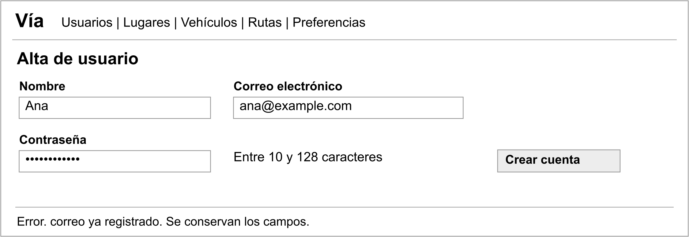
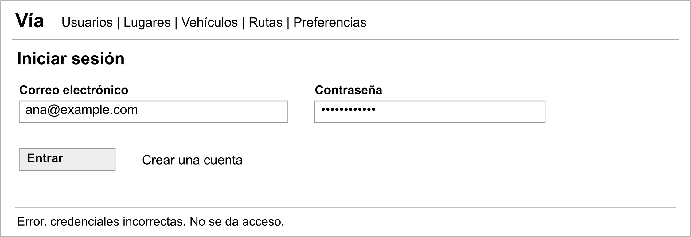
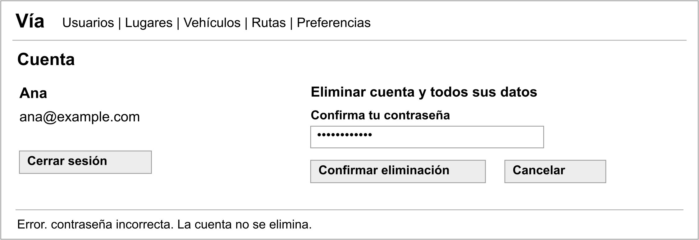
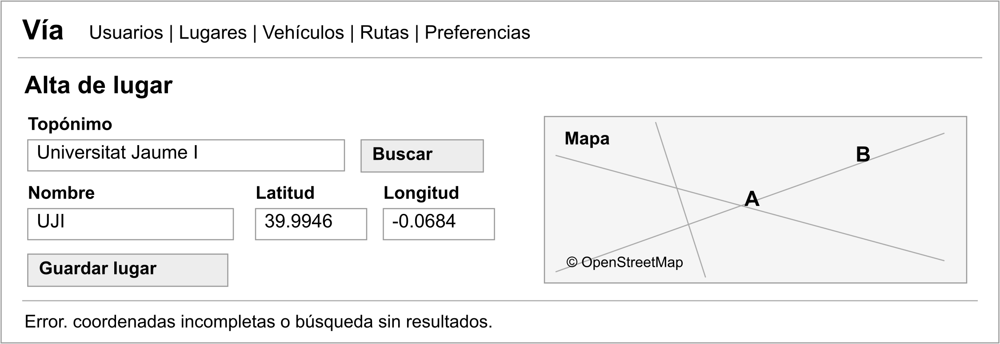
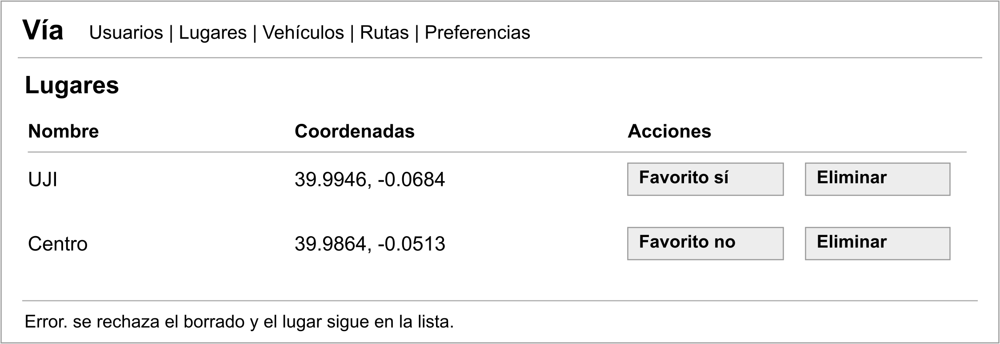
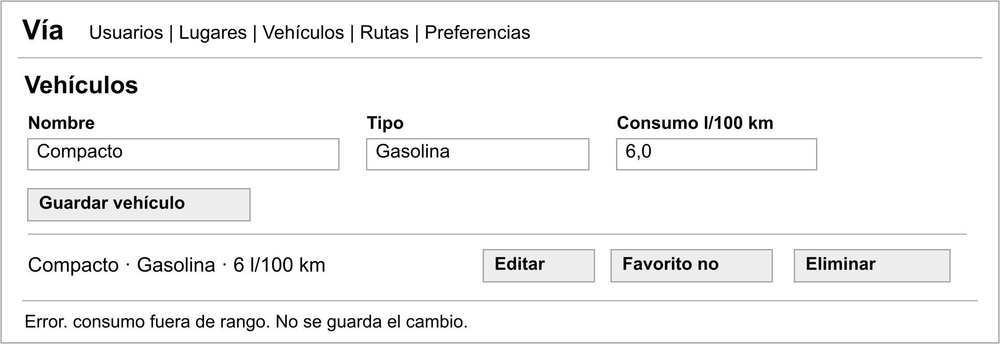
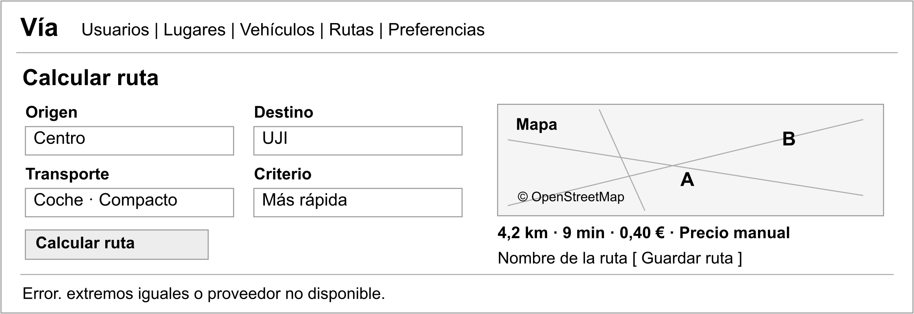
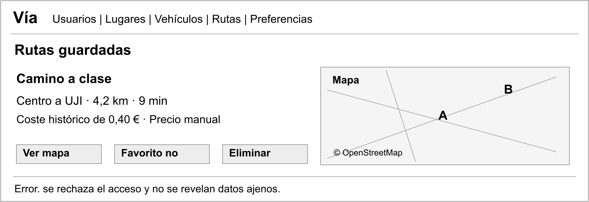
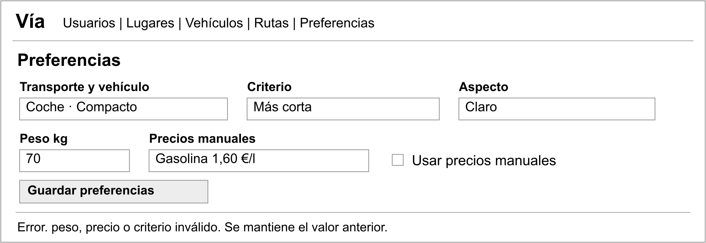

# Diseño de interfaces

Los mockups muestran los campos, acciones y errores principales de cada función. Se mantienen las mismas etiquetas y unidades que en los escenarios. La navegación separa las funciones, los errores conservan los datos introducidos y el borrado requiere confirmación con opción de cancelar. Las cifras de los diseños son ejemplos.

HU-25 y HU-26 se reflejan en la recuperación de las mismas listas y preferencias, sin una pantalla adicional. En móvil el formulario y el mapa se muestran en una sola columna. El mapa tiene una alternativa de entrada por coordenadas. M06 usa kWh/100 km en eléctricos. M07 muestra euros en coche y kcal a pie o en bicicleta, con los tres modos y criterios disponibles.

Los diseños se pueden consultar juntos en [la galería](../../entrega1/03_Mockups/index.html). Cada pantalla conserva una versión SVG editable y otra PNG.

## M01 Alta de usuario

HU-01

## M02 Acceso

HU-02

## M03 Cuenta

HU-03 y HU-04

## M04 Alta de lugar

HU-05, HU-06 y HU-09

## M05 Lugares

HU-07, HU-08 y HU-22

## M06 Vehículos

HU-10 a HU-13 y HU-22

## M07 Cálculo y resultado

HU-09 y HU-14 a HU-19

## M08 Rutas guardadas

HU-20 a HU-22

## M09 Preferencias

HU-15 a HU-17, HU-23 y HU-24

