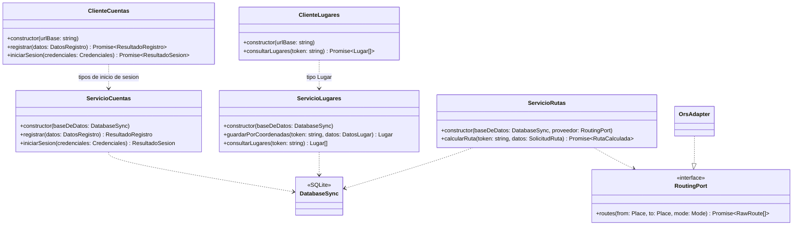

# UML del SUT de la IT1

Diagrama de clases del sistema bajo prueba en la fase roja de ATDD. Los constructores reciben las dependencias que preparan las pruebas de aceptación.

| Historia | Operación del SUT | Entrada y resultado |
| --- | --- | --- |
| HU-01 | `ServicioCuentas.registrar` | `DatosRegistro` contiene nombre, correo y contraseña. `ResultadoRegistro` devuelve el identificador. |
| HU-01, E-01-I5 | `ClienteCuentas.registrar` | Recibe los mismos datos de alta. La prueba de conexión comprueba que una interrupción HTTP se comunica como error. |
| HU-02 | `ServicioCuentas.iniciarSesion` | `Credenciales` contiene correo y contraseña. `ResultadoSesion` devuelve un token y los datos públicos de la cuenta (identificador, nombre y correo). |
| HU-02, E-02-I4 | `ClienteCuentas.iniciarSesion` | Recibe las mismas credenciales. La prueba comprueba el aviso de fallo de conexión sin devolver una sesión. |
| HU-05 | `ServicioLugares.guardarPorCoordenadas` | Recibe el token de sesión y `DatosLugar` con nombre, latitud y longitud. Devuelve un `Lugar` con identificador, nombre y coordenadas. |
| HU-07 | `ServicioLugares.consultarLugares` | Recibe el token de sesión y devuelve los lugares de la cuenta. |
| HU-07, E-07-I2 | `ClienteLugares.consultarLugares` | Recibe el token de sesión. La prueba distingue un fallo de conexión de una lista vacía. |
| HU-14 | `ServicioRutas.calcularRuta` | Recibe el token de sesión y `SolicitudRuta` con los identificadores de origen y destino y el modo (`aPie`, `bicicleta` o `coche`). `RutaCalculada` contiene la geometría, la distancia en metros y la duración en segundos. |

Los nombres de los tipos definidos en línea en TypeScript se abrevian en el diagrama para facilitar la lectura. `OrsAdapter` es el adaptador de OpenRouteService del spike que se pasa a `ServicioRutas` en las pruebas.
